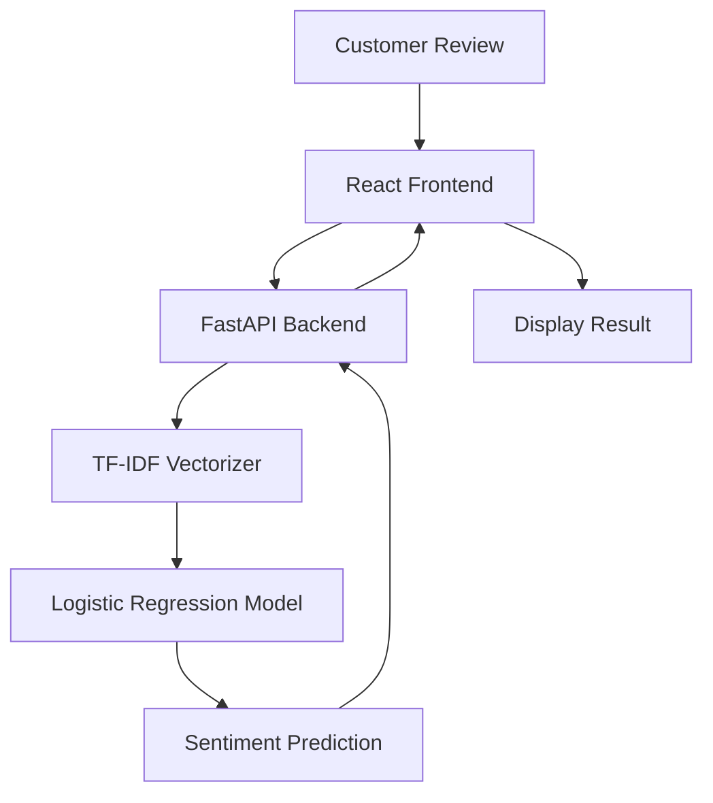
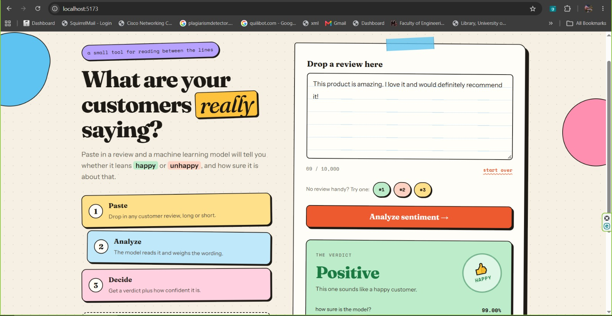
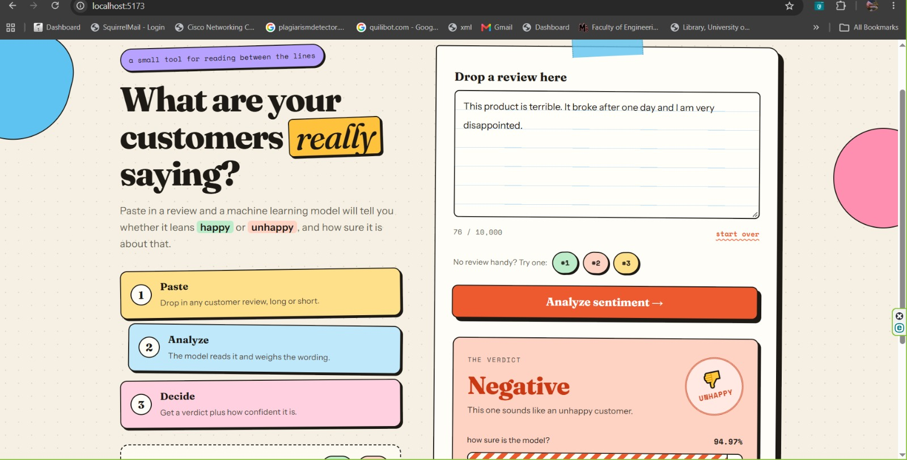

# Customer Feedback Intelligence System

A machine learning web application that analyzes customer reviews and classifies them as **positive or negative** using TF-IDF and Logistic Regression. The application integrates a trained machine learning model with a FastAPI backend and a React frontend.

## Features

- Sentiment classification of customer reviews.
- Text feature extraction using TF-IDF.
- Logistic Regression classification.
- Interactive React frontend.
- FastAPI REST API for predictions.
- Prediction confidence score when available.
- Model evaluation using accuracy and a confusion matrix.

## Technology Stack

| Category | Technologies |
|---|---|
| Programming | Python, JavaScript |
| Data analysis | Pandas |
| Machine learning | Scikit-learn, Logistic Regression |
| NLP | TF-IDF |
| Backend | FastAPI, Uvicorn |
| Frontend | React, Vite, CSS |
| Model persistence | Joblib |
| Version control | Git, GitHub |

## System Architecture




## Machine Learning Workflow

1. **Data exploration:** Examined review data, sentiment distribution, missing values, duplicates, and review lengths.
2. **Feature extraction:** Converted review text into numerical features using TF-IDF with unigrams and bigrams.
3. **Model training:** Trained a Logistic Regression classifier using labelled customer reviews.
4. **Model evaluation:** Evaluated predictions on a separate test dataset.
5. **API integration:** Saved the trained pipeline and integrated it with FastAPI.
6. **Frontend integration:** Connected the React interface to the prediction API.

## Dataset

The working dataset contains 25,000 customer reviews.

| Dataset | Number of reviews |
|---|---:|
| Training | 20,000 |
| Testing | 5,000 |
| **Total** | **25,000** |

The dataset contains positive and negative sentiment labels. Raw and processed data files are excluded from Git version control.

## Model Performance

The TF-IDF and Logistic Regression model achieved **88.50% test accuracy**.

| Evaluation | Result |
|---|---:|
| Test accuracy | 88.50% |
| Correct predictions | 4,425 |
| Incorrect predictions | 575 |

### Confusion Matrix

| Actual / Predicted | Positive | Negative |
|---|---:|---:|
| Positive | 2,311 | 254 |
| Negative | 321 | 2,114 |

The results show that the model correctly classified 4,425 of the 5,000 test reviews.

## Application Screenshots

### Positive Sentiment Prediction



### Negative Sentiment Prediction



*Add screenshots captured from the running application using the filenames above.*

## Project Structure

```text
customer-feedback-ai/
├── app/
│   └── main.py
├── data/
│   ├── raw/
│   └── processed/
├── docs/
│   └── images/
│       ├── positive-prediction.png
│       └── negative-prediction.png
├── frontend/
│   ├── src/
│   ├── package.json
│   └── vite.config.js
├── models/
│   └── sentiment_pipeline.joblib
├── src/
│   └── models/
│       ├── train_sentiment.py
│       ├── predict_sentiment.py
│       ├── evaluate_sentiment.py
│       └── compare_models.py
├── requirements.txt
└── README.md
```

## Installation and Setup

### Prerequisites

- Python
- Node.js and npm
- Git

### 1. Clone the Repository

```bash
git clone https://github.com/OshaniKR/customer-feedback-ai.git
cd customer-feedback-ai
```

### 2. Set Up the Backend

Create and activate a virtual environment in Windows PowerShell:

```powershell
python -m venv .venv
.\.venv\Scripts\Activate.ps1
```

Install dependencies:

```powershell
pip install -r requirements.txt
```

Ensure `models/sentiment_pipeline.joblib` exists before starting the backend.

Start FastAPI:

```powershell
python -m uvicorn app.main:app --reload
```

Backend URL: `http://127.0.0.1:8000`

API documentation: `http://127.0.0.1:8000/docs`

### 3. Set Up the Frontend

Open a second terminal:

```powershell
cd frontend
npm install
npm run dev
```

Open the local URL shown by Vite, usually `http://localhost:5173`.

Keep both terminals running while using the application.

## API Endpoints

| Method | Endpoint | Purpose |
|---|---|---|
| GET | `/` | Check that the API is running |
| GET | `/health` | Check backend health and model status |
| POST | `/predict` | Predict the sentiment of a review |

### Example Prediction Request

```json
{
  "review": "This product is excellent and I am very happy with it."
}
```

The response includes the submitted review, the predicted sentiment label, and a confidence percentage when supported by the model.

## Limitations

- Predictions may be incorrect for ambiguous, sarcastic, or mixed-sentiment reviews.
- The model supports only the sentiment categories it was trained to predict.
- Confidence scores do not guarantee prediction correctness.

## Author

**Oshani Ranathunga**

- GitHub: [OshaniKR](https://github.com/OshaniKR)
